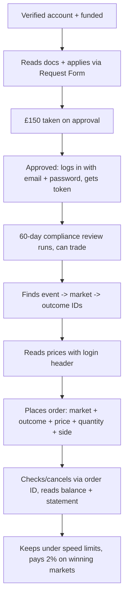

# INTERNAL — API Cover for CS With No Coding Background

**INTERNAL ONLY. Do not send to customers. Owner: API Support. Updated Oct 2026.**
**You are the reader: a CS agent who has never coded. You are covering API tickets. You do not need to learn to code. You need to picture what the customer is doing, recognise which stage they are stuck at, ask one or two plain questions, give the standard fix, and know when to hand to technical.**
**Use with: `training/confluence_draft_v2.md` (full code lookup, use second), VOICE_CORE_PINNED.md (every customer reply must pass it), `skills/smarkets-api-support/SKILL.md` (escalation workflow). This page teaches you the story. That page is the dictionary.**

## If you remember nothing else (5 facts)

1. The API is the website without buttons. Same exchange, same bets, same money. The customer's tool sends written requests, Smarkets sends written replies.
2. Login = email + password in a field called `username` -> reply contains a `token` (success is 201, not 200) -> every later request carries the header `Authorization: Session-Token <token>`. Wrong field name, wrong status check, wrong header words = most first-login tickets.
3. Money has funny units. Stake 20000 = £2 (pounds x 10000, minimum 500). Odds 5000 = 2.0 (10000 divided by odds). "I sent 800 expecting £2" always means £0.08.
4. Logins die around 20 minutes even when busy (rotation), and login allows 5 tries per 5 minutes. Short jobs: log in fresh each run. Long jobs: re-login once on 401, never loop.
5. 403 JSON = account permission. 403 HTML (starts `<`) = network block (VPS/cloud/country). Never guess which without seeing the body. Price checks: 50/min approved, batch 200 IDs per call, over-batch 404 means too many IDs not dead route.

## How to use this page

- New to cover? Read top to bottom once (about 25 minutes). It follows one customer from application to first bet.
- On a live ticket? Ctrl+F the customer's words ("logged out", "forbidden", "insufficient funds", "£0.08", "too many requests"). Each section ends with **Ask** (what to ask, max 2, no curl/jargon) and **Hand to technical when**.
- Replying? Adapt a line from Covering tickets, then run it through Voice Core (plain text, straight quotes, no em dashes, one decision last, correct sign-off).

## 1. What the API actually is (60 seconds)

Forget code. Picture the website: you click matches, odds, Place Bet. Behind each click the website sends a note to Smarkets ("show me Arsenal markets", "back Arsenal £2 at 2.0") and gets a note back.

The API is those same notes without the website. A customer's tool (their own program, or Zapier/Make/n8n/Bubble/Sheets) sends the notes directly.

Three words customers use:

- **Endpoint** = which desk the note goes to. Each desk has an address (URL) like `https://api.smarkets.com/v3/events/` (list matches) or `/v3/orders/` (place bets). Method says what kind of note: GET = read, POST = place, DELETE = cancel.
- **JSON** = the note format. Labelled data like `{"balance": 100000}`. Their tool turns it into fields they map in a builder. You never need to parse it, just recognise field names (`token`, `price`, `quantity`, `error_type`).
- **Header** = the envelope. The login pass (`Authorization: Session-Token <token>`) travels in the envelope on every request after login. Wrong envelope = 401.

It is the Smarkets exchange only (customers bet against each other, can back and lay, commission applies). It is not SBK (the sportsbook app, bet against the house, multiples/Bet Builders/cash out/free bets). Same login can work on both but money and products are separate. If a ticket talks about Bet Builders, accas, cash out or free bets on the API, they are mixing products. Ask Step 0: "Are you using the API or the website/SBK app?"

What the API can do: list events/markets/outcomes, read live prices/volumes, place/list/cancel exchange orders, read balance/exposure/statement, automate own trading on approved markets. What it cannot: test mode with fake money (does not exist), read-only/data-only feed (one product: prices + betting together), push feed/websocket/streaming (poll on a timer only, old stream host is dead), multiples/accas/Bet Builders/cash out (website/SBK only).

## 2. The whole journey (follow one customer)

You triage by finding which box they are stuck in. Onboarding questions (A-E) go to section 3-4. "Cannot find/price/bet" (F-H) go to 5-6. "After betting" (I) goes to 7. "Too fast/blocked" goes to 8. Codes go to 9.

## 3. Onboarding: verified to approved

Every API customer walks this path. Most "cannot bet" tickets are stuck at one of these steps, not a code bug.

**1. Verified account.** Electronic checks first (no credit score effect). If they fail: photo ID (passport, driving licence, national ID — photo/scan, all corners, no screenshots) plus proof of address (bank statement/utility bill within 3 months, or council/tax bill this year, paper or PDF — no screenshots, no mobile bills). Same document cannot cover both. Target 72 hours for document review. They can also be asked for source of funds/wealth later (payslips, bank/savings statements). Standard regulation. Until done: deposit blocks, bet blocks, login blocks with KYC/ACCOUNT_UNVERIFIED. Fix is on smarkets.com, API follows by itself.

**2. Funded.** At least £150 for the fee plus stakes. Own-name method, account currency. Visa Debit or Instant Bank Transfer simplest. Name mismatch (joint/married/abbreviation) = deposit fails on money laundering rules.

**3. Applies.** The Request Form (support.smarkets.com/p/6MLL-PL7/api-request-form). Expect 3-5 plain sentences: tool, sports/markets, price-check cadence, bets per day. They must tell Smarkets if the setup changes a lot later. No fixed approval time. Nudge via api@smarkets.com (tech) or support@smarkets.com (account) if stale. Smarkets can refuse even if everything looks fine.

**4. £150 fee.** One-off, taken from balance on approval not application. Refundable only if they permanently quit API use within 60 days (via support@smarkets.com). After that: normal commission, no API discount, no 0%/affiliate offers for API users.

**5. Approved + 60-day review.** No separate API key arrives. They log in with normal email + password (next section). The 60-day compliance review runs while they trade. Some restrictions can apply. They do nothing unless contacted.

**Ask:** "Where are you stuck — verification, deposit, the form, or first login?" plus "What tool and roughly how many markets per minute and bets per day?" **Hand to technical when:** approval-delay disputes, jurisdiction edge cases, fee-refund disputes.

Build order you should preach: login -> balance check -> one batched price check -> one tiny manual-triggered bet (£0.05-£1) -> then automate. Never start automations on day one.

## 4. First login: the wristband story

Tell yourself this story and every 401 makes sense.

Login is getting a wristband. The customer shows email + password at the door (POST https://api.smarkets.com/v3/sessions/, body field MUST be called `username` with the email as the value, plus `password`). The door hands back a wristband (field called `token`, long string). Success is number 201, not 200 — tools that only accept 200 show a working login as failed. They also get a `refresh_token` and hints (`stop`, `verify`/`factor`).

Every later request must show the wristband in the envelope: header `Authorization: Session-Token <token>`. Exact words `Session-Token`, one space, token. Not `Bearer`. Not in the URL or body. Test: GET https://api.smarkets.com/v3/accounts/ with that header returns balance. Balance back = login works.

Authenticator app (MFA) accounts get a limited wristband at login. One more step before bets: POST https://api.smarkets.com/v3/sessions/verify/ with the current 6-digit code. Signature of skipping: login looks fine, every order 401s.

Logout is handing the wristband back: DELETE https://api.smarkets.com/v3/sessions/ with the same header (limit 30/60s). Tidy for scheduled runs.

**How long it lasts.** About 30 minutes, renewed by each call — but wristbands also rotate about every 20 minutes (proven Oct 2026: header-only setups die around 19-20 min even while polling every 20s; cookie setups sending both cookies and adopting the renewed token sailed past 30 min). So: short jobs (under 15 min) just log in fresh each run and log out. Long jobs need a branch: on 401 run Login once, swap the stored token, retry that step once, then stop and alert. Never loop login. Login allows 5 tries per 5 minutes, then ~4-5 min lockout. Debugging burns it fast.

The three classic first-login failures: used `email` as the field name (must be `username`), checked for 200 only (allow 200 OR 201), looked for `session_token` (read `token`).

Login error words and what they mean: INVALID_CREDENTIALS (wrong email/password, reset on website), PASSWORD_RESET_NEEDED (reset first), INVALID_TOKEN (wrong MFA code, wait for next 30s code), DEVICE_NOT_TRUSTED/IP_NOT_TRUSTED (finish device trust on website), SESSION_LIMIT_REACHED (log out elsewhere), USER_SUSPENDED (talk to support@smarkets.com), USER_SELF_SUSPENDED/USER_ON_TIMEOUT/USER_EXCLUDED (timeout/exclusion active), SOURCE_BLOCKED/CLIENT_JURISDICTION_MISMATCH (source/country mismatch), COUNTRY_BLOCKED 451 (not licensed there, server must move), 429 on login (hit 5/5min, wait for window).

**Ask:** "What field names did you put in the login body — did your guide say `email` or `username`?" / "What status did the login step report, and does your tool treat anything except 200 as failed?" / "Minutes until it fails — about 20, or after sitting idle? One scenario or several sharing the account? Authenticator app on?" Never ask for token values. Never ask them to run curl. **Hand to technical when:** device/session/source/jurisdiction codes, any 403 on login, HTML body on login, 401 on POST but GET fine, mentions of cookies/auth v2/refresh, `data: None`, 401 persisting after fresh login + verify.

## 5. Finding events and prices

Four levels, always in order. Use one example and reuse it: Event (Arsenal vs Chelsea) -> Market (Match Winner) -> Contract (Arsenal Win / Draw / Chelsea Win) -> Order (their bet on one contract). They need the ID from each level for the next. Wrong ID anywhere = 404.

Free lists (no login): events, event states (open/halted/settled — check before betting), competitors (teams/runners), markets for events, market counts, contracts (outcomes), currencies (AUD BRL CAD CHF CZK DKK EUR GBP HKD HUF JPY NOK PLN SEK USD).

Live numbers (login header always): quotes (current order book), last_executed_prices (what really traded last + when), volumes (how much traded), orders (open + recently settled), fullcover (list-only multiple type, cannot place on Smarkets), accounts + activity (balance + paginated statement).

Walk you can picture: find event ID in events -> its markets -> one market's contracts -> quotes with header for live book (pick prices from here) -> states to confirm open. Have them do it once by hand in docs.smarkets.com (fills token for them), then copy working URLs into their tool. IDs travel as comma lists in one URL up to that endpoint's cap (section 8).

Website shows a price but quotes is empty? Normal, not broken. Quotes shows only other customers' orders. The website can show extra pricing the API does not expose. Quiet live markets are often empty via API. Cross-check last_executed_prices. No push feed, webhook, websocket or streaming exists. Poll quotes on a timer. Hosts found via DevTools (sio-live etc) are website internals, not API — do not build on them.

**Ask:** "Which market ID, and does last_executed_prices show recent trades on it?" **Hand to technical when:** liquid-market persistent empties with evidence, or customer disputes the P2P explanation.

## 6. Placing bets: the 5 ingredients

Every bet needs 5 things on POST https://api.smarkets.com/v3/orders/: `market_id`, `contract_id`, `price`, `quantity`, `side`. Two smart extras: `type` (what survives pauses) and `label` (their own tag like "sheets-arsenal-1" for filtering later).

**Side.** `buy` = back = WILL happen. `sell` = lay = WON'T happen (ties up liability, needs available balance). Betfair mapping buy=BACK sell=LAY. No `time_in_force` field exists (their layer or another exchange — Smarkets uses `type` + `minimum_accepted_quantity`).

**Price (odds).** Not decimal odds. Decimal = 10000 / price. So 2.0 -> 5000, 4.0 -> 2500, 10.0 -> 1000, 1.39 -> 7194. Range 1-9999 on valid ticks only. Rejected INVALID_PRICE = copy a price from quotes instead of typing.

**Quantity (stake).** Not pounds. Pounds = quantity / 10000. So £0.05 -> 500 (minimum), £1 -> 10000, £2 -> 20000, £10 -> 100000. "Sent 800 expecting £2" is always £0.08. Back-stake maths quantity x price / 100000000 (e.g. 100000 x 5000 / 100000000 = £5).

**Type (what survives).** Blank = `good_til_halted` (carries into live, dies on any halt). `keep_in_play` = survives halts and resumes (the ONLY type that stays in the book through a halt — never promise "orders stay in"). `good_til_cancelled` = dies going live (pre-match only). `immediate_or_cancel` = take what is available now, cancel the rest. Fill-or-kill = IOC + `minimum_accepted_quantity` = `quantity`. Fill-at-least-X = IOC + minimum lower. Always set minimum explicitly on IOC or it can zero-fill.

**Reply.** They get `order_id` (save it, how you track/cancel), `total_executed_quantity` (instant fill, key for IOC), `executed_avg_price` (null if unmatched), `available_balance`, `exposure`, plus echo. No `quantity_filled`/`state` here — those are GET-only (created/partial/filled/settled).

**Delays are normal.** Racing/darts 4s, everything else 8s. Pending + invisible during delay. Instant Match 8-14s confirmation (material event inside can void). Cannot place while halted. In-play markets with a delay are NOT halted for every goal/penalty/red.

**Ask:** "What exact rejection code word is in the reply?" plus "What available (not total) did accounts show just before, and was the market in-play?" **Hand to technical when:** IOC full-minimum still partial-fills (need exact quantity/min + full reply + paper/live), SERVICE errors persisting, any code outside the groups in section 9.

## 7. After betting: check, cancel, balance, statement

**Check.** GET /v3/orders/ = open + recently settled with `quantity_filled` + `state`. Filter by `label`. Placed but invisible = filled instantly (check last trades), cancelled by halt/close, or wrong account. Non-instant types confirming only means accepted — matching needs the other side.

**Cancel.** One: DELETE /v3/orders/{order_id}/ (10/s). All: DELETE /v3/orders/ (1/60s, kills EVERYTHING — never on auto-retry/trigger). Cannot cancel = already filled/cancelled/settled, wrong ID, or not theirs. After settlement nothing cancels. Re-cancel of dead order succeeds silently (safe to retry once).

**Balance.** GET /v3/accounts/: `balance` (total), `exposure` (locked in open orders), `available_balance` (balance minus exposure = what you can stake), `commission_type` (0.02/0.01/0.03), `currency`, `bonus_balance`, `account_id`, `signup_date`. "Has money but cannot bet" is always exposure first — cancel an open order to free it.

**Statement.** Paginated GET /v3/accounts/activity/ (timestamp_max/offset/limit) for "last N" in Sheets. Hour CSV GET /v3/account_activity_csv/{start}/{end}/ is strict: both ISO 8601 on the hour (2026-05-19T14:00:00Z), exactly 1 hour apart, else 400 INVALID_DATETIMES. No data that hour = 404 NO_CSV_AVAILABLE. Too broad = RECKONATOR_REQUEST_TOO_LARGE. Reply is gzipped CSV (Make/n8n need Gunzip, Zapier needs Code/Sheets import, Bubble needs file plugin).

**Ask:** "What does GET /v3/orders/ show for that order ID — state and quantity_filled?" / "Cancel-one or cancel-everything step?" / "What exact start/end strings did the CSV step send? Available vs balance?" **Hand to technical when:** throttle/capacity persisting at low volume, rare INSUFFICIENT_FUNDS on cancel, valid hour-window still INVALID_DATETIMES.

## 8. Speed limits and batching (where cover agents save accounts)

Two layers. Global 1200 calls per 60 seconds per account across every tool/server/token sharing it. Unauthenticated public calls do not count, but live prices need auth anyway. Seven stricter caps fire first: list events 600/60s; quotes 50/60s approved (about 20 pre-approval — header is ground truth for their tier); login 5/300s; logout 30/60s; place 10/s; cancel-one 10/s; cancel-all 1/60s. Rest share the 1200 pool.

429s: most GETs carry structured `count`/`limit`/`expiry` (expiry is RFC 2822 date, wait until then, then halve rate). Quotes/orders/sessions 429 is short with NO expiry (wait ~60s, slow down). Repeat violations suspend then permanently revoke. Slow down first time, every time. Responses can carry Limit/Remaining/Reset headers (occasionally negative/missing — wait at least 5s).

Batching is the fix that changes behaviour. Every list endpoint takes many IDs in ONE call:

| Call | Max IDs per call |
|---|---|
| quotes | 200 |
| volumes / states / competitors | 300 |
| contracts / last prices | 100 |
| markets by event / counts | 50 |

Do THEIR maths: 1500 markets at 200 = 8 calls/sweep (about every 10s within 50/min). At 100 = 15 calls (about every 18s). At 1 each = blocked instantly. Over cap gives confusing 404 "Nothing matches the given URI" — count IDs, route is not dead (quotes flips 200->404 at 201, volumes at 301). Before any increase talk, double the batch — it usually removes the need. One timer fanning out beats five timers. Cache event/contract lists for minutes, poll only quotes/balance fast. Never poll login or cancel-all. Sharing one account across tools stacks against the same pool — ask tool count + cadence + batch size.

Increase asks get batch advice FIRST, then Michael's verbatim line only: "We are unable to review quote limit increases at this time, once you've built a larger sample size of activity we can review and request this for you." No dates, no thresholds, no aggregate totals, never all six limits, never reroute to api@smarkets.com in customer text (we ARE support). Internal truth never in customer text: bar is market maker level.

**Ask:** "How often does the timer run, how many IDs per call (comma count in that URL), and is anything else using the same account?" **Hand to technical when:** limits hit at genuinely low single-client volume (hidden second client?), suspension after 429s, approved account stuck on 20 header (server mismatch for correction, never "force 20->50" as override), short-429 with no recovery.

No streaming/websocket/push exists for API users (deprecated service, REST polling only, scope denial to API, never name sio-live/archived SDK). That plus batching answers most "follow X markets / need faster" tickets.

## 9. Errors: master table + the 403 split

2xx worked (200 OK, 201 created = login). 4xx = their request needs fixing. 5xx = Smarkets side, wait + retry once.

| Customer sees | Means | Your move |
|---|---|---|
| 401 AUTH_REQUIRED | logged out / MFA missing / 20-min rotation | fresh login flow (section 4), MFA verify if needed, re-login-once branch |
| 403 JSON FORBIDDEN + code | account permission (approval / 60-day review / revoked / scope / RG_ACK / KYC / NO_DEPOSITS / ACTION_BLOCKED) | website fix or approval check, email api@smarkets.com path with IDs |
| 403 HTML `<...` / SOURCE_BLOCKED / IP_NOT_TRUSTED | network edge block (VPS/datacentre IP, reputation, or server country) | home test to prove host vs setup, take ownership, internal allowlisting only for supported-jurisdiction IPs on api.smarkets.com |
| 400 validation / BAD_REQUEST | wrong field/ID/price, read `data` | name the bad field from `data`, IDs from level above |
| 400 INVALID_DATETIMES | CSV times not on hour / not 1h apart | snap to `:00:00Z`, end = start + 1h |
| 400 RECKONATOR_TOO_LARGE | activity query too broad | narrow dates |
| 404 NO_CSV / NO_RESULTS | no data that hour / no match | another hour / fresh IDs |
| 404 "Nothing matches URI" on batch | too many IDs | split to caps in section 8 |
| 414 too many IDs | same | smaller batches |
| 429 too fast | hit cap | wait to `expiry` (or ~60s), batch more, poll slower |
| 451 country blocked | unsupported country | contact support if moved |
| 500/503/504 incl ZEUS_TIMEOUT | Smarkets side | wait, retry once, escalate with time + endpoint + code |

Bet rejects in plain words. Money/limits: INSUFFICIENT_FUNDS (exposure — check available, cancel or stake less), STAKE/LIMIT/CAPACITY (too big/busy — reduce or contact support), NO_DEPOSITS (fund first). Market state: SETTLED/CONTRACT_SETTLED/NOT_OPEN/NOT_FOUND (done or stale IDs — re-walk), HALTED/SUSPENDED/CANCELLED_HALTED (paused — wait, re-check states, KIP next time). Wrong values: INVALID_PRICE (copy from quotes), INVALID_QUANTITY (min 500). Conflicts: CROSSED_SELF (would match own order — move price), THROTTLE (over 10/s — slow). Account: ACCOUNT_SUSPENDED/ACTION_BLOCKED (support), KYC/ACCOUNT_UNVERIFIED (verify on website), RG_ACK_REQUIRED (gambling popup on website, instant), COUNTRY_BLOCKED (451). System: SERVICE_TIMEOUT/UNAVAILABLE (wait, retry once). Cancel rejects: NOT_FOUND (bad ID), NOT_LIVE (already resolved), TOO_LATE (settled), TRADING_SUSPENDED, THROTTLE/CAPACITY/LIMIT, rare INSUFFICIENT_FUNDS on cancel.

The 403 split is the one to get right. Always get the body first: "open the raw response — does it start with `{` or `<`? If `{`, paste error_type + data words only, redact token. Home wifi or cloud server? ID checks + first deposit done?" JSON = permission path. HTML = network path (do not hammer, do not promise unblock, only confirm api.smarkets.com, unsupported-country server must move). Suspension/compliance disputes need human judgement — no detailed internal reasoning unless pre-approved.

**Hand to technical when:** HTML 403 always; SOURCE/IP/JURISDICTION codes; 451 from supported country; unparseable logs; pattern miss; persistent 5xx (with exact code + UTC time + endpoint); approved-but-20 mismatch; quotes-empty dispute; IOC dispute; suspension/compliance.

## 10. Money, commission, payments, safer gambling

**Commission.** Standard 2% of net profit per market, win-only, netted per market. API gives no discount. No 0%/affiliate for API users. Pro 1% is opt-in at 1500 bets or £1M/month (ask at 80% via support, never automatic, can stay on 2%, charges per matched bet on wins AND losses, forfeits promos, 3-month minimum). Select 3% auto at £25k/12mo net (+7d email, forfeits promos, review if P&L drops, discretionary). Decode GET accounts `commission_type` first: 0.02/0.01/0.03. Never promise Pro approval or Select removal. Worked line: £10 back at 3.0 wins £20 profit -> £0.40 commission.

**Deposits/withdrawals.** Free, mostly instant, £10 min (£25 PayPal), own-name method, account currency. Limits in Settings, lowering instant, raising needs cooling (~72h). Withdrawals are closed loop by law: same method as deposit. Per method Net Deposits = Deposits - Withdrawals; zero each positive method before skimming profit elsewhere (e.g. £100 Visa + £50 Mastercard, to take £150 to Mastercard first return £100 to Visa). Timings: Instant Bank ~12h, Trustly/e-wallets 1-2d, cards 1-6d, Bank Transfer 5-10d (£20 min, last resort, currency must match, needs statement + verification). E-wallets: 4th+ withdrawal in 7 days takes 24h. Some Mastercards return net deposits only. Stuck checklist: above minimum? deposit method? card overused in 12h? address/country changed? removed method? Else fresh Instant Bank deposit or bank transfer via support.

**KYC/RG.** Same on API as website, no exemption. RG_ACK: website popup (try market page), lifts instantly. Timeout 1/7/31/42d locks everything incl cashier (support can pull funds mid-timeout), auto-reopens, never early. Self-exclusion 6mo/1y/5y/permanent, balance back 48h, never early, fixed terms need support contact to reopen (not automatic), permanent never reopens. Limits in Settings. GAMSTOP/multi-operator, GamBlock/BetBlocker/NetNanny, Gamblers Anonymous/GamCare/GambleAware/NHS/Clinic/Therapy, US 1-800-GAMBLER. Source of funds/wealth/affordability can land anytime (job/income, payslips/P60/SA302, card/bank/savings, solicitor letter). Never contact employer. Provide or face deposit block -> bet block -> suspension.

## 11. Betting rules that break automations

Full rules in Help Centre (General 1-11 + sports). What matters for API tickets:

Settlement ASAP on the official result that day. Later amendments do not change it. Can delay if uncertain, void if unresolvable, resettle if settled in error or new info (disqualification, cheating).

Voids (stake back): cancelled, not concluded within 36h of scheduled start, postponed more than 36h past original start, change of opponents/venue, modified length. Surface change alone does NOT void. Dead heats split winnings.

Football default 90 min + stoppage only. Extra time/pens do NOT count unless stated (want them? "To Advance" includes them). Own goals do not count for goalscorer. Cards yellow 1, straight red 2, two yellows + red 3, max 3 per player, subs/managers do not count. Abandoned voids unless already decided; no resumption news in 3h voids undecided.

Tennis: first set not done voids all (except decided lines). Retirement after set one: retiree loses Match Winner, Set Betting voided. Venue/surface change stands. Final-set Championship Tie Break = 1 game.

Racing: first past post then weighed-in counts, later appeals ignored. Non-runner voids bets on it, places >= runners voids all, ante-post stands run or not. Places: 5-7 pays 2, 8-15 pays 3, 16+ non-handicap 3, 16+ handicap 4 (market name wins). Reduction factor: New = Old x ((100 - RF)/100), e.g. 4.0 at 25% -> 3.0. Win: under 2.5% stands, 2.5%+ adjusts matched, cancels unmatched, reopens. Place: ANY RF adjusts winnings, cancels unmatched. Can apply after the race.

In-play/KIP/trade-out: delays/confirmation as section 6. Keep-in-play must be set per bet (Rule 10) — non-KIP unmatched dies at halt, KIP keeps queue. Trade out is per contract, never guaranteed. SBK cash out is a different product. Erroneous bets: report within 60 min to support@smarkets.com with time/contract/market/price/reason before result (unless exceptional). Outliers beyond ±20% fair price can be viewed later at discretion. Other side traded out can leave placer liable for difference.

"Why voided?" walk: abandoned/cancelled/36h? -> non-runner RF? -> same-event builder leg voided (ANY voided leg voids WHOLE bet, stake back, even if other legs lost; cross-event just reduces odds)? -> erroneous? -> resettled in error?

## 12. Rules that protect accounts (quote exactly once, then apply)

Allowed: viewing prices + placing bets on approved markets, automating own trading. Tell Smarkets on big setup changes.

Banned (T&Cs s2/s5/s6/s7): odds scraping, concealing calls as browser traffic, impersonation, reverse engineering, lots of data without matching trading, sharing/selling/distributing prices/market/event data without written approval, benchmarking markets/prices/liquidity/systems, extra accounts to dodge fees (fraud), latency arbitrage, court-siding, anything harmful to the exchange. Monitored: request patterns, data-to-trade ratios, behaviour, limit circumvention.

Penalties: warning -> temporary suspension -> permanent API/account removal, plus bets voided and possible legal action. Serious (fraud, data theft) can skip to removal. Access can go anytime without notice; Smarkets not liable for losses from restricted access.

Security is on the customer: email/password/tokens. Never in shared templates, public sheets, client-side pages, public repos. Leaked: change password on smarkets.com now, DELETE sessions, email support@smarkets.com. One person per account.

Pattern B for denials: one acknowledging line, direct answer quoting the operative line once (e.g. s2 "All other uses are strictly prohibited, including but not limited to, odds scraping, concealing API calls, browser impersonation or reverse engineering."), <=2 sentences constraint, optional alternative, close. No padding. Test-mode ask: "The public API specification does not document a test or sandbox environment."

## 13. Covering tickets: your workflow + words

**Workflow.** Default first action: 2-4 diagnostic questions, not the fix. They reveal the real stage. Probe + side-note pattern when you see a likely factor but cannot confirm mechanism (e.g. German VPS + 403: ask for full body, note location as likely factor, never claim Cloudflare without body). Prefer one soft hypothesis + ONE confirming evidence (full 429 body with limit/expiry/count, or response text). Ask recurrence ("has this happened since?") not reconstruction. Keep facts separate from policy wording. Quote binding T&Cs exactly, do not narrate them.

Routing: API bugs/codes/limits/auth/batching -> api@smarkets.com path via tech. Account/money/ID/application/RG/closed loop/fee/compliance -> support@smarkets.com path. SBK app -> support@getsbk.com / live chat 09:00-23:00 GMT / +44 207 617 7413. Outages: status.smarkets.com / @SmarketsTech.

**Handoff (one message, key points only).** Platform confirmed (API), approval state if known, symptom in CUSTOMER'S words, full error (status + error_type + data + expiry if 429 + JSON-vs-HTML), exact call (method + URL + field names, secrets redacted), expected vs actual, start time, poll rate + batch size + tool count, home vs cloud, which confluence section already given.

**Voice in 30 seconds.** Every sentence does one of: fact, decision, reason, next step. No empathy-only sentences. Short info/denial ~120-200 words. Complaints: Acknowledge (1 neutral line) -> Review (what checked + finding) -> Reason (rule + how it applies to THESE facts) -> Action (ONE decision sentence last). Banned: Unfortunately, I'm sorry to say, I understand, the upside is, furthermore, additionally, Please be advised, I can confirm that, should-you-need實現. Plain text only, straight quotes, no em dashes, no hyphenated compounds (except `in-play`), negative count <= 3, UK English. Sign-off exactly "Kind regards, / [name] / Smarkets Support". Never refer to spec/schema/OpenAPI (say "API documentation"). Never reroute to api@smarkets.com in customer text. Never name colleagues (say "live chat agent"). Complaints route (IBAS/eCOGRA) only if they explicitly asked, Michael instructed, or final position on filed complaint.

**Copy-adapt (tune before sending).**

Login: "Thanks for your message. Log in with POST https://api.smarkets.com/v3/sessions/ using `username` (your email as the value) and `password`. A working login returns 201 with a `token`. Set that step to accept 200 or 201 and save `token`. Add the header `Authorization: Session-Token <token>` to every later call and test with GET https://api.smarkets.com/v3/accounts/. Login allows 5 tries per 5 minutes, so pause before retrying after a 429. Kind regards, [name] Smarkets Support"

Logged-out loop: "Thanks for your message. Sessions rotate about every 20 minutes, so long runs need a re-login branch. On a 401 run Login once, replace the stored token and retry that step once, then stop and alert if it fails again. For runs under 15 minutes the simplest fix is a fresh login each run with a logout at the end. Kind regards, [name] Smarkets Support"

Quantity: "Thanks for your message. The API counts stake in 1/10,000ths of your currency, so [their number] is [£x]. To stake [£y] send quantity [N] (pounds x 10000, minimum 500). Kind regards, [name] Smarkets Support"

Price: "Thanks for your message. The API counts odds as 10000 divided by decimal odds, so [their number] means [odds]. To bet at [odds] send price [N]. If a price is rejected, copy one straight from the quotes reply. Kind regards, [name] Smarkets Support"

Rate limit + batch: "Thanks for your message. The quotes allowance is 50 requests per 60 seconds per account, shared across every tool on the account. Batching changes most setups. Quotes takes up to 200 market IDs in one call, so [their volume] needs [N] calls per sweep. Wait until [expiry / about a minute] then re-run at that batch size with one timer. We are unable to review quote limit increases at this time, once you've built a larger sample size of activity we can review and request this for you. Kind regards, [name] Smarkets Support"

Batch 404: "Thanks for your message. That 404 means the batch held more IDs than the endpoint takes, not that the route is dead. Quotes takes up to 200 IDs per call [volumes/states/competitors 300, contracts/last prices 100, markets by event 50]. Split to those sizes and re-run. Kind regards, [name] Smarkets Support"

RG_ACK: "Thanks for your message. Your account is approved, place no new application. Log in at smarkets.com and complete the Responsible Gambling acknowledgement popup (try a market page if it does not show), then retry the same API call with no other change. Kind regards, [name] Smarkets Support"

Streaming: "Thanks for your message. Prices come from polling the documented REST endpoints. There is no streaming or push feed for API users and the old streaming service is deprecated. Poll quotes (up to 200 market IDs per call, 50 requests per 60 seconds) on a timer instead. Kind regards, [name] Smarkets Support"

## Glossary (one line each)

Event / Market / Contract / Order: match -> bet type -> outcome -> your bet. Back (buy) / Lay (sell): WILL / WON'T happen. Price: 10000/decimal (5000 = 2.0). Quantity: £x10000 (20000 = £2). Exposure / Available / Balance: locked / spendable / total (available = balance - exposure). Token / Session: login pass, ~20-30 min. MFA / Verify: authenticator + extra step. KIP / GTH / GTC / IOC / FOK: survive halt / die on halt / die going live / take-now / all-or-nothing. Quotes / Last / Volumes: live book / last trade / how much. 401 / 403 / 404 / 429 / 451 / 5xx: logged out / not allowed / not found / too fast / country / our side. Batch / Poll: many IDs one call / re-check on timer. RF: odds cut on non-runner. Void: stake back. Dead heat: tie split. Halt: paused. Delay / Confirmation: 4s/8s wait / 8-14s Instant Match wait. Trade out (exchange) / Cash out (SBK). Closed loop / Net deposits: same-method withdrawals / deposits minus withdrawals. Expiry / Headers: reset time / Limit-Remaining-Reset. RG_ACK / KYC: website popup / ID checks. Fullcover: multiple type, list-only. Commission 0.02/0.01/0.03: 2%/1%/3%.

## Links + escalation (same list, keep open in tabs)

Docs https://docs.smarkets.com/ (live spec https://api.smarkets.com/v0/control/openapi/?tags=trading_api is truth, local copy can be stale). Form https://support.smarkets.com/p/6MLL-PL7/api-request-form. T&Cs https://help.smarkets.com/hc/en-gb/articles/34697834941085-Smarkets-API-Access-Integration-T-Cs. Commission https://help.smarkets.com/hc/en-gb/articles/212654665-Smarkets-commission-FAQ. Help https://help.smarkets.com/hc/en-gb. Base https://api.smarkets.com. Tech path api@smarkets.com. Account path support@smarkets.com.

*Sources: live OpenAPI spec, docs.smarkets.com, API T&Cs, Commission FAQ, Help Centre rules/payments/RG, ticket precedents (30 Sep increase wording, 12 Oct batching briefs, 1 Oct rotation + batch-boundary probes). If docs conflict with this page, docs win. Flag the page for update.*
